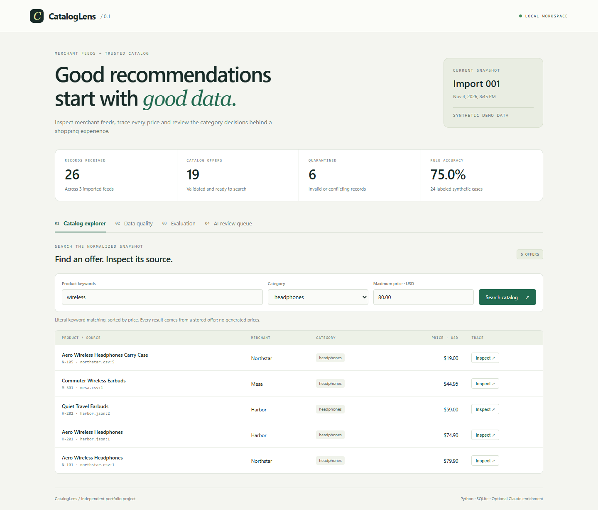

# CatalogLens

**Product feed validation, SQL search and reviewable AI category suggestions.**

A shopping assistant can return a convincing answer built on a bad product record.
CatalogLens puts a small inspection layer between merchant feeds and the catalog:
validate prices, quarantine broken offers, preserve provenance, then consider model
suggestions separately from approved product facts.

The demo uses three fictional merchants. It runs locally with Python 3.11 or newer,
uses only the standard library and makes no network requests. Claude enrichment is
optional and requires a separately configured API key.



## Run it

From the repository root:

```sh
python -m cataloglens demo
python -m cataloglens serve
```

Open **http://127.0.0.1:8000**. On systems where Python is named `python3`, substitute
that command. No `pip install`, account, database service or frontend build is needed.

The dashboard has four views: catalog search, quarantined records, the labeled
evaluation fixture and the model review queue. Inspect an offer to see its original
feed, record number, price in cents and category provenance.

## What the demo actually does

| Stage | Result |
| --- | --- |
| Ingest | Read UTF-8 CSV and JSON from three synthetic feeds |
| Validate | Check required text, explicit USD currency and unambiguous prices |
| Deduplicate | Collapse matching offers within a merchant/SKU identity |
| Quarantine | Reject every record in a conflicting identity group |
| Store | Save an atomic SQLite snapshot, source hashes and rejected-row reasons |
| Search | Query stored offers by keywords, category and maximum USD price |
| Evaluate | Compare the fixed keyword baseline with 24 labeled synthetic examples |
| Enrich, optionally | Ask Claude for a category plus a supporting source quote |
| Review | Approve or reject suggestions before changing a stored category |

The catalog contains offers, not a universal product identity graph. Matching names
from different merchants remain separate offers. Search does not invent prices,
infer stock, recommend credit or execute purchases.

## Reproduce the numbers

```sh
python -m unittest discover -s tests -v
python -m cataloglens evaluate --output reports/local-rules.json
python -m cataloglens search wireless --category headphones --max-price 80.00
```

The bundled import has **26 records: 19 accepted offers, 6 quarantined records and
1 collapsed duplicate**. Every received record belongs to exactly one count.

The `keywords-v1` baseline matches **18 of 24 labels (75%)**. The checked-in
[evaluation report](reports/baseline.json) includes per-category precision/recall
and each individual outcome. This is a small, hand-labeled fixture, not a production
benchmark or evidence that a model improves accuracy.

Six cases fail: a computer described without a laptop keyword, four accessory or
ambiguous-name cases, and a merchant description containing an instruction with a
category keyword. The last case exposes lexical contamination: the rule matcher
does not execute the instruction, but it still counts the misleading word.

## Inspect your own feed

```sh
python -m cataloglens --db local.db import path/to/shop.csv path/to/shop.json
python -m cataloglens --db local.db report
python -m cataloglens --db local.db serve --port 8001
```

Required fields: `merchant`, `sku`, `title`, `price`, `currency`.
`description` is optional. A JSON feed is an array of objects; CSV uses a comma
delimiter and a header row. Quote price fields that contain commas.

```json
[
  {
    "merchant": "Example Shop",
    "sku": "A-101",
    "title": "Wireless Headphones",
    "description": "Over-ear headphones with a foldable headband.",
    "price": "79.90",
    "currency": "USD"
  }
]
```

Accepted price examples: `79`, `79.90`, `$79.90`, `79,90`, `1,299.00`, `1.299,00`.
`1,299` is rejected because its meaning is ambiguous. There is no currency conversion.
Values must be positive and at most USD 1,000,000. Each file is limited to 2 MB and
10,000 records; title and description lengths are bounded too.

An invalid row is quarantined. A malformed file aborts the entire batch before it
changes the active snapshot. Re-importing produces a new snapshot; it does not
append stale offers to current search results. Earlier snapshots remain in SQLite.

## Optional Claude suggestions

Set `ANTHROPIC_API_KEY` and `ANTHROPIC_MODEL` in your shell. `.env.example` documents
the names; the application does not auto-load `.env` files. Choose a model available
to your Anthropic account; the project does not assume a particular model identifier.

```sh
python -m cataloglens suggest 1 --allow-paid-api
python -m cataloglens reviews
python -m cataloglens review 1 approve
```

`1` is an example product/suggestion ID; use IDs returned by search and reviews.
To decline a suggestion, replace `approve` with `reject`.

Each suggestion sends only the selected title and description to Anthropic, uses
the Messages API with a category tool schema, and records the model, prompt version,
token counts and elapsed time. It makes one request with a 30-second timeout and
does not retry automatically. The explicit flag permits paid API usage; it does
not set a dollar budget. Use synthetic or otherwise authorized data.

The response must have exactly the expected fields and a valid category. For a
non-`other` suggestion, a supporting quote must occur verbatim in the supplied text.
That check prevents invented evidence; it **does not prove the category is correct**.
Suggestions remain pending until reviewed. Prices and descriptions cannot be
changed through this flow, and reviewed decisions retain their provenance.

To measure live model suggestions against the same fixture:

```sh
python -m cataloglens evaluate --provider claude --allow-paid-api --output reports/local-claude.json
```

This makes **24 paid requests**. Compare its outcomes with `reports/baseline.json`.
The report includes tokens and latency; monetary cost depends on the chosen model
and its current pricing. No live Claude accuracy, cost or latency result is included
in this repository. The API adapter is covered by offline contract/error tests.

API references: [Messages](https://platform.claude.com/docs/en/api/messages/create)
and [tool definitions](https://platform.claude.com/docs/en/agents-and-tools/tool-use/define-tools).

## Design choices and limits

- **Integer cents:** decimal input is parsed with `Decimal`, then stored as an
  integer. Binary floating-point values never enter money calculations.
- **Conservative conflicts:** differing records with the same case-insensitive
  merchant/SKU key invalidate the entire group. There is no last-write-wins price.
- **Parameterized queries:** user input is never evaluated as SQL. `%` and `_` are
  literal search characters, not user-controlled wildcard operators.
- **Read-only dashboard:** only fixed assets and GET APIs are served, bound to
  loopback with a Host allowlist and a restrictive content security policy.
  Feed/model text is inserted with `textContent`, not interpreted as HTML.
- **Narrow classification:** five categories, a deliberately simple frozen baseline,
  and visible failure cases. There is no trained classifier, semantic search,
  conversational agent or production monitoring in this version.
- **Local storage:** SQLite retains source records and history without encryption
  or a retention policy. This is a local development tool, not a hosted service.
- **Reproducibility:** tests and demo require no key. Live model responses are not
  deterministic; a schema-valid suggestion can still be wrong or manipulated.

See [architecture and tradeoffs](docs/architecture.md), the
[demo walkthrough](docs/demo.md) and the [Portuguese learning guide](docs/learning.pt-BR.md).

Independent portfolio project. No affiliation with Sezzle or any merchant.

MIT licensed.
